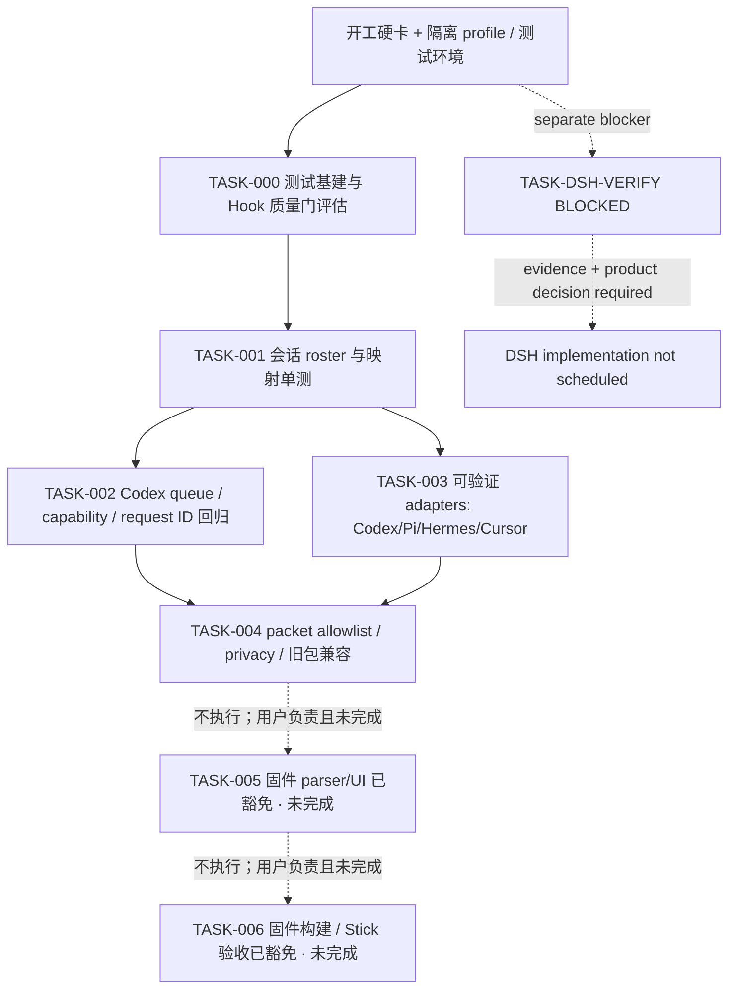

# 开发计划：多助手 Stick 状态与确认（Reviewed · 用户批准修订版）

## 阅读上下文与评审决定

本计划基于已批准的 PRD、原型、测试用例、自动化测试计划和概念技术方案拆成任务；用户已批准本次修订后的剩余执行边界。用户明确：本切片不做固件构建或 Stick 验收；固件显示、翻页、设备行为和 DSH 接入都保持未验证。固件与设备相关工作由用户负责，本轮不新增 host 测试入口、不改固件、不连接/刷写/操作 Stick。TASK-005 固件 parser/UI 与 TASK-006 固件构建/Stick 验收均记为“已豁免 · 未完成”，不作为通过或完成证据。计划已批准，但开发阶段保持 Draft，不能据此宣称切片完成。

获批后也必须先完成 `$product:kickoff` 开工硬卡。**DSH 实际接入未验证，DSH adapter 实现、安装、启用和 AC-008 验收任务继续暂停，不得启动。** 本计划用 `BLOCKED` 标记接缝核验任务，不把 DSH fixture/mock 当真实集成证据。若核实无可用受支持接缝，回产品负责人修订 PRD 并重新批准，不静默删范围。

产品批准范围仍为单机本机 bridge + 一台 Stick，助手状态与 Codex-only 设备决策规则不变；本轮计划执行范围不包括固件/设备交付。PRD 中 DSH 仍是已批准目标，但接缝未验证，DSH adapter 实现、安装、启用和 AC-008 验收继续不启动。当前已完成 bridge 侧任务不等于 Stick 可见功能完成或整刀验收。追踪依据仍为 `prd.md` AC-001..010、`prototype.html`、`test-cases.md` TC-001..026、`automation-test-plan.md` AUTO-TASK-001..007 和 `technical-solution.md` U-001..U-005。

## 实现上下文与证据

Repo Wiki 已读 `docs/repo-wiki/index.md`、`architecture.md`、`development.md`。它指引固件、bridge、插件和现有验证入口；Wiki 明确未覆盖完整调用图/所有 JSON 字段，命令与字段以本轮源码回查为准。源码定位：

- `tools/codex_usage_ble_bridge.py`：`AgentHub.ingest_hook()`、`apply_to_snapshot()`、`UsageSnapshot.packet()` 和 `CodexApprovalProxy` IPC/队列；当前 Hub 以 assistant ID 聚合，packet 只写当前 agent/index/count 与 quota。
- `tools/agent_hub_notify.py`、`integrations/agent-hub/`、`plugins/codex-usage-stick/scripts/hook_entry.py`：本机 presence 和 Codex permission socket 客户端；`integrations/agent-hub/install_presence.py` 安装 Cursor/Pi/Hermes，未接 DSH。
- `src/data.h`：`_applyJson()` 解析现有 agent 和 quota 字段；`src/main.cpp`：会话 chrome 与 `drawApproval()`；`src/ble_bridge.cpp`：NUS transport。
- 离线测试入口：`tools/test_agent_hub.py`、`tools/test_provider_quota.py`；固件构建入口：`pio run -e m5stack-sticks3`。Wiki/README 只证明命令来源，本轮未运行。设备操作入口 `tools/test_serial.py`、`tools/test_xfer.py` 不进入离线门禁。

Repo Wiki 的执行影响：模块 ownership 保持单仓 bridge/插件/固件；接口族群沿用本机 Unix socket + BLE NUS；状态与队列由 bridge 所有；设备决定门禁仍由 Codex proxy；发布采用可选 packet 字段与旧格式 fallback。Wiki 未提供 DSH 稳定接缝、容量和 UI 字段约束，分别保留阻断/测量任务。实现只能在本仓，不涉及门户、远程服务或持久化迁移。

### 未决事项、影响任务及开工限制

| 编号 | 未决工程问题 | 影响 | 限制/恢复条件 |
|---|---|---|---|
| B-001 / U-001 | DSH plugin/profile mount、实际生命周期 payload、卸载与到 bridge 的端到端路径未验证 | AC-008、TC-018、AUTO-TASK-007、DSH 部分 AUTO-TASK-003 | `TASK-DSH-VERIFY` 阻断；不启动 adapter 实现/安装/启用。提供受支持 API/version 与隔离 profile 真实事件证据后，回产品负责人复核并另行批准解除 |
| B-002 / U-002 | 各来源真实 stable session key、cwd 字段及结束事件需对照 | AUTO-TASK-001/003、TC-001..009 | `TASK-001` 前完成现有 payload 盘点；只为源码/文档已有且测试可控字段写映射；未知来源保持安全降级 |
| B-003 / U-003 | 实际 Stick packet 接收容量、屏幕分页与横竖屏布局未验证 | AUTO-TASK-004..006、TC-025..026 | 本切片不做固件构建或 Stick 验收；这些设备指标保持未验证。仅保留 Python packet 小样估算，不得宣称设备容量/布局验收 |
| B-004 / U-004 | 固件 JSON parser host-test seam 未确认 | AUTO-TASK-005、TC-022 | 用户明确不另建 host test、不改固件；本切片跳过该验证并记未验证，不把构建或文本断言替代 parser 行为测试 |
| B-005 / U-005 | Codex 原生/设备决策竞态需回归确认 | AUTO-TASK-002、TC-010..017 | `TASK-002` 保持现有实现和 ID 契约；任何扩大授权模型的改动都停下复核 |

用户明确同意 U-001 未验证继续保持暂停，因此可编排其余独立实现工作；这一授权不等于接受 DSH 不可接入或 AC-008 失败，也不授权改 PRD。其它 blocker 若影响已批准架构/API/权限或验证命令，先停对应任务并返回技术方案/用户评审。

## 文件职责图与顺序



该图表达同一工作区上的串行依赖：Hub 数据模型、Codex 授权门、adapter payload 和 packet 契约共享 `tools/codex_usage_ble_bridge.py` 与当前 packet；不并行编辑这些共享文件。TASK-005/006 由用户负责且均已豁免、未完成，不属于本轮可执行工作；不进行固件构建和 Stick 验收。计划/记录不得暗示固件会消费 packet 或 Stick 已支持 roster/翻页。DSH 核验与业务实现隔离，不得借 parallel work 启动实现。

## 有序任务

| 任务 / 责任角色 | 文件范围与 Ownership | 关联 / RED → GREEN 验证 | 依赖、回滚与状态 |
|---|---|---|---|
| TASK-000 单测与 hook 基建准备（用户负责，已豁免 · 未完成） | 不新增统一测试入口、机器可读报告或 hook 配置；沿用现有业务测试命令 | AUTO-TASK-001..005；本切片不做基建验证；统一入口和报告能力仍未完成 | 用户负责后续补齐；不阻断本切片内已授权的离线业务测试。不得标成通过 |
| TASK-001 会话身份 roster（bridge owner） | `tools/codex_usage_ble_bridge.py`、`tools/test_agent_hub.py` | AC-001..004、TC-001..009、AUTO-TASK-001；历史用户回执：RED 10 tests/2 failures，后 GREEN `PYTHONPATH=tools python3 -m unittest tools/test_agent_hub.py`，13 tests/OK | 已完成的历史任务；其离线回执不证明设备功能。回滚仅限本任务文件改动。`DONE` |
| TASK-002 Codex 请求队列安全回归（bridge/插件 owner） | `tools/codex_usage_ble_bridge.py`、`plugins/codex-usage-stick/scripts/hook_entry.py`（仅必要范围）、`tools/test_approval_proxy.py` | AC-005..007、TC-010..017、AUTO-TASK-002；历史用户回执：`PYTHONPATH=tools python3 -m unittest tools/test_approval_proxy.py`，10 tests/OK | 已完成的历史离线任务；回执不证明真实 Codex app-server/Stick E2E。回滚仅限本任务文件改动。`DONE` |
| TASK-003 验证过的非 DSH adapter 合同（adapter owner） | `integrations/agent-hub/`、`tools/agent_hub_notify.py`、`integrations/agent-hub/install_presence.py`、`tools/test_agent_adapters.py` | AC-001..004、TC-003..009、TC-019、AUTO-TASK-003 部分；历史用户回执：`PYTHONPATH=tools python3 -m unittest tools/test_agent_adapters.py`，6 tests/OK | 已完成的离线 fixture/安装器测试，不证明真实助手运行时接入或设备显示。DSH 不在此 TASK。回滚仅限本任务文件改动。`DONE` |
| TASK-DSH-VERIFY DSH 接缝证据核验（产品/DSH 技术责任人） | **不得改动**用户 profile；证据先记录在本计划执行记录/后续评审材料；未获另外授权不新增插件、不运行 profile | AC-008、TC-018、AUTO-TASK-007；RED：隔离 profile 下无法证实受支持安装和真实生命周期路径；GREEN 条件：记录兼容 API/version、受支持 mount、真实 start/activity/end payload 至本机 Hub/Stick 的事件证据，并经产品负责人复核 | 独立 blocker；**状态 BLOCKED，禁止启动 DSH adapter 的实现、安装、启用和真实用户配置修改**。若无法接入，回产品负责人修订 PRD，不删范围。该任务核验通过也不自动批准实现 |
| TASK-004 packet contract 与隐私 | `tools/codex_usage_ble_bridge.py`、`tools/test_provider_quota.py`、`tools/test_packet_privacy.py`；此处只记录 Python packet 合同，不代表固件已经消费 | AC-003、005..010；TC-005..006、020..022；AUTO-TASK-004；历史用户回执：`PYTHONPATH=tools python3 -m unittest tools/test_packet_privacy.py tools/test_provider_quota.py`，23 tests/OK | 已完成的离线 packet privacy/quota 测试。设备端字段解析、容量和分页仍未验证。回滚仅限本任务文件改动。`DONE` |
| TASK-005 固件 parser/UI（用户负责，已豁免 · 未完成） | 本切片不改 `src/data.h`、`src/main.cpp`，不建 host seam/test | AC-001..006、010；TC-022..026；AUTO-TASK-005；本切片验证命令：不适用（用户明确跳过，且禁止源码测试替代 parser 行为证据）；未生成 RED/GREEN | 已完成依赖准备，但由用户在本切片之外处理；不连接/刷写/操作 Stick。状态保留“已豁免 · 未完成”，无回滚动作，因为未改固件。固件解析、显示、翻页、portrait/landscape、按键一律未验证 |
| TASK-006 固件构建与 Stick 验收（用户负责，已豁免 · 未完成） | 本切片不运行固件构建命令，不连接 Stick、不配对、不刷写、不跑串口设备脚本 | AC-005..010；TC-016..026；AUTO-TASK-006；本切片验证命令：不适用（用户明确排除构建和设备验收），没有 RED/GREEN 或设备验收证据 | 依赖 TASK-005；仍由用户负责，且本次切片不执行。固件构建、BLE/配对、审批回执、队列设备行为、兼容与屏幕容量保持未验证。此豁免不改变 TASK-DSH-VERIFY 的阻断状态 |

**AUTO-TASK 映射完整性：**001→TASK-001；002→TASK-002；003→TASK-003 + DSH 部分由 TASK-DSH-VERIFY 阻断；004→TASK-004；005→TASK-005（本切片已豁免 · 未完成，由用户负责）；006→TASK-006（本切片已豁免 · 未完成，由用户负责）；007→TASK-DSH-VERIFY（阻断，真实 adapter 实现不排期）。对应验收不可因豁免改标通过。

## 可执行验证命令清单与报告

历史 bridge 离线命令及用户回执见 `develop.md` 和 `wrap-up/develop/`；这些不构成本轮新鲜测试。本轮仅修订计划，不运行业务测试：

```bash
python3 -m unittest tools/test_agent_hub.py tools/test_provider_quota.py
```

TASK-000 按 state 的用户豁免仍“已豁免 · 未完成”。本计划不列可执行的固件构建/设备验收命令：本轮明确不做固件构建，不连接、配对、上传、刷写或操作 Stick，也不运行 `tools/test_serial.py`、`tools/test_xfer.py`。仓库没有已确认 CI/report artifact；TASK-000 由用户负责后续补齐，本切片不加入口和报告配置。任何缺失的构建/设备证据都记 `not-run`，不可标通过。

## 评审、发布和回滚

评审门：TASK-001 完成后检查 roster key 与未知 session 降级；TASK-002 完成后专门审查安全决策 capability 与旧 request ID；TASK-003 完成后检查适配器合同；TASK-004 完成后审 packet allowlist/隐私和历史兼容。TASK-005/006 本切片均已明确豁免并由用户负责，固件与设备行为为未验证；不据此宣称双屏、设备浏览或 E2E 通过。任何其他离线检查不得冒充编译、设备或真实 DSH 接入证据。

本轮没有发布授权。bridge Python packet 层不等于完整产品；因 TASK-005/006 豁免，固件显示、分页、设备行为、构建和 Stick 验收均未验证。DSH 未接入验证前 AC-008 仍未验证，本切片不得报最终完成或发布“支持五助手”。若将来由用户接手固件/设备工作，按另行批准流程记录固件/bridge 版本与实测，不在此计划中预设成功。

不并行实现边界：TASK-001、002、003/004 按批准顺序串行完成；本轮已完成阶段不重新并行编辑共享 bridge。TASK-005/006 由用户负责，且本次明确不执行。TASK-DSH-VERIFY 只能在另行授权下做证据核验，不能与 adapter 实现绑定成“顺手完成”；DSH adapter 实现/安装/启用保持禁止。

## 对抗审查

### 人机两句

1. 未参加会话的评审人可看到本切片交付边界、Codex-only 设备决策、DSH 暂停、未验证风险与用户待决事项：通过。
2. 工程师只读本计划及已批产物可区分已完成 bridge 离线任务、TASK-005/006 用户豁免和 DSH 阻断；本切片没有可继续的已批准实现任务。固件构建和 Stick 验收不执行，也没有把未运行命令冒充验证：通过。

### 三轴

| 轴 | 发现 | 处置 |
|---|---|---|
| 规格 | DSH 仍在已批范围中，不可静默取消；用户本轮排除设备交付 | 保留 AC-008 / TC-018 / AUTO-TASK-007 并阻断 DSH；TASK-005/006 明确豁免未完成，不作为验收通过 |
| 可判定 | 历史单测回执可能被误读为本轮新鲜验证或设备通过 | 将任务表标为历史离线结果；明确无固件构建/Stick 验收命令、无设备证据，任务状态可判定 |
| 事实 | 技术方案概念字段、Wiki 命令和 DSH 候选 API 可能被误读为实现事实 | DSH mount/payload 未验证；固件显示、翻页、设备行为未验证；本轮没有执行构建/设备操作 |

**审查结论：**未发现需要回改已批准 PRD 或技术方案的范围冲突；DSH 和运行环境仍有明确 blocker，固件/设备任务明确豁免且未完成。计划保持 Draft 等用户审阅与批准。不得以批准本计划解除 DSH 接入暂停；其解除条件须有真实接缝证据并经产品负责人再次决定。本计划批准也不自动代表 develop 阶段完成。

## 尚未解决的不确定项

- DSH 接入契约与真实生命周期/端到端路径（阻断 DSH adapter 实现和 AC-008，恢复条件见 B-001）。
- 多助手实际 session/cwd 字段及无关联时的真实降级路径；逐来源映射须源码/合同/隔离测试核实。
- Roster/pending 最大容量、BLE packet/分片预算、portrait/landscape 可读性需测量。
- 固件 parser host-test seam 与报告 artifact 能力需 TASK-000/005 先核实；本计划未声称已具备。
- 本切片不做固件构建或 Stick 验收；固件显示、翻页、设备行为及 DSH 接入均未验证。若后续需处理，另行计划/授权，不在本次改计划中执行。

请评审上述 TASK 顺序、文件 ownership、TDD/验证门、TASK-DSH-VERIFY 阻断边界和设备操作授权条件。用户批准本计划后仍只进入 `$product:kickoff` 门禁，不自动修改代码或用户配置。
