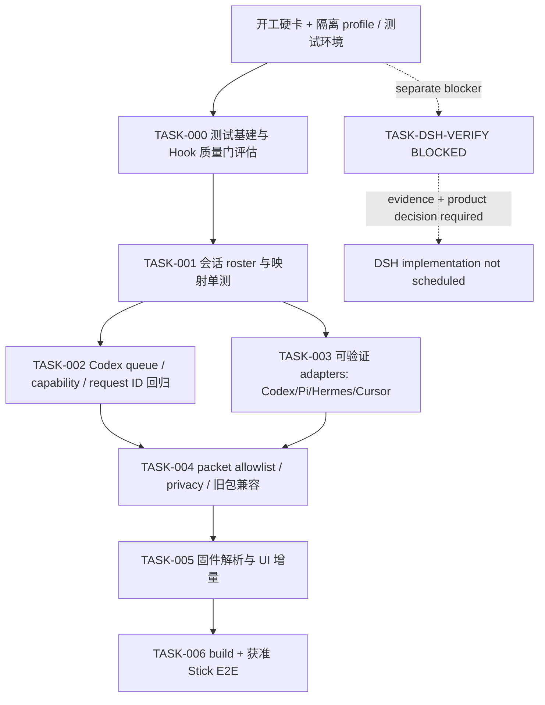

# 开发计划：多助手 Stick 状态与确认（Draft）

## 阅读上下文与评审决定

本计划把已批准的 PRD、原型、测试用例、自动化测试计划和概念技术方案拆成可执行任务，供用户、bridge/固件维护者评审任务顺序、单测基建、设备验证门禁和未决阻断处置。计划不代表任务已分派或代码已开始。

获批后也必须先完成 `$product:kickoff` 开工硬卡。**DSH 实际接入未验证，DSH adapter 实现、安装、启用和 AC-008 验收任务继续暂停，不得启动。** 本计划用 `BLOCKED` 标记接缝核验任务，不把 DSH fixture/mock 当真实集成证据。若核实无可用受支持接缝，回产品负责人修订 PRD 并重新批准，不静默删范围。

目标是单机本机 bridge + 一台 Stick，按 Codex、Pi、Hermes、Cursor、DSH 会话显示助手名、项目末级名称与会话短标识；设备批准/拒绝仅开放给经验证完整闭环的 Codex 请求，其它来源只显示原生 UI 提示。范围和授权依据：`prd.md` AC-001..010；交互参考 `prototype.html`；用例 `test-cases.md` TC-001..026；自动化拆解 `automation-test-plan.md` AUTO-TASK-001..007；架构与 U-001..U-005 见 `technical-solution.md`。

## 实现上下文与证据

Repo Wiki 已读 `docs/repo-wiki/index.md`、`architecture.md`、`development.md`。它指引固件、bridge、插件和现有验证入口；Wiki 明确未覆盖完整调用图/所有 JSON 字段，命令与字段以本轮源码回查为准。源码定位：

- `tools/codex_usage_ble_bridge.py`：`AgentHub.ingest_hook()`、`apply_to_snapshot()`、`UsageSnapshot.packet()` 和 `CodexApprovalProxy` IPC/队列；当前 Hub 以 assistant ID 聚合，packet 只写当前 agent/index/count 与 quota。
- `tools/agent_hub_notify.py`、`integrations/agent-hub/`、`plugins/codex-usage-stick/scripts/hook_entry.py`：本机 presence 和 Codex permission socket 客户端；`integrations/agent-hub/install_presence.py` 安装 Cursor/Pi/Hermes，未接 DSH。
- `src/data.h`：`_applyJson()` 解析现有 agent 和 quota 字段；`src/main.cpp`：会话 chrome 与 `drawApproval()`；`src/ble_bridge.cpp`：NUS transport。
- 离线测试入口：`tools/test_agent_hub.py`、`tools/test_provider_quota.py`；固件构建入口：`pio run -e m5stack-sticks3`。Wiki/README 只证明命令来源，本轮未运行。设备操作入口 `tools/test_serial.py`、`tools/test_xfer.py` 不进入离线门禁。

Repo Wiki 的执行影响：模块 ownership 保持单仓 bridge/插件/固件；接口族群沿用本机 Unix socket + BLE NUS；状态与队列由 bridge 所有；设备决定门禁仍由 Codex proxy；发布采用可选 packet 字段与旧格式 fallback。Wiki 未提供 DSH 稳定接缝、容量和 UI 字段约束，分别保留阻断/测量任务。实现只能在本仓，不涉及门户、远程服务或持久化迁移。

### 未决事项、影响任务及开工限制

| 编号 | 未决工程问题 | 影响 | 限制/恢复条件 |
|---|---|---|---|
| B-001 / U-001 | DSH plugin/profile mount、实际生命周期 payload、卸载与到 bridge 的端到端路径未验证 | AC-008、TC-018、AUTO-TASK-007、DSH 部分 AUTO-TASK-003 | `TASK-DSH-VERIFY` 阻断；不启动 adapter 实现/安装/启用。提供受支持 API/version 与隔离 profile 真实事件证据后，回产品负责人复核并另行批准解除 |
| B-002 / U-002 | 各来源真实 stable session key、cwd 字段及结束事件需对照 | AUTO-TASK-001/003、TC-001..009 | `TASK-001` 前完成现有 payload 盘点；只为源码/文档已有且测试可控字段写映射；未知来源保持安全降级 |
| B-003 / U-003 | 会话/请求容量、BLE payload 分片预算、屏幕真实布局未测量 | AUTO-TASK-004..006、TC-025..026 | `TASK-004/005` 前测量；未定上限不可宣称容量验收 |
| B-004 / U-004 | 固件 JSON parser host-test seam 未确认 | AUTO-TASK-005、TC-022 | `TASK-004` 探查后决定最小测试方式；不得大规模重构固件造测试性 |
| B-005 / U-005 | Codex 原生/设备决策竞态需回归确认 | AUTO-TASK-002、TC-010..017 | `TASK-002` 保持现有实现和 ID 契约；任何扩大授权模型的改动都停下复核 |

用户明确同意 U-001 未验证继续保持暂停，因此可编排其余独立实现工作；这一授权不等于接受 DSH 不可接入或 AC-008 失败，也不授权改 PRD。其它 blocker 若影响已批准架构/API/权限或验证命令，先停对应任务并返回技术方案/用户评审。

## 文件职责图与顺序



该图表达同一工作区上的串行依赖：Hub 数据模型、Codex 授权门、adapter payload 和 packet 契约共享 `tools/codex_usage_ble_bridge.py` 与当前 device packet；不并行编辑这些共享文件。固件任务只在 packet 字段/预算冻结后开始。DSH 核验与业务实现隔离，不得借 parallel work 启动实现。

## 有序任务

| 任务 / 责任角色 | 文件范围与 Ownership | 关联 / RED → GREEN 验证 | 依赖、回滚与状态 |
|---|---|---|---|
| TASK-000 单测与 hook 基建准备（Python/仓库维护者） | 测试 runner/report 选择及 hook 配置候选；若确需改动，仅限项目级测试/提交门禁配置与文档。先执行 `$unit-test-init` 的范围评估，再 `$git-hook-init` 评估；不扩 CI | AUTO-TASK-001..005；RED：确认当前根级无统一 runner/report、无自定义 hooks 的事实（非故意失败测试）；GREEN：给出可重复离线 Python unittest 命令及报告能力现状；如果现有入口已足够，则保留缺口记录并不造 runner。命令待该评估确认，不能在此伪装成现存命令 | kickoff 后、业务单测前。Hook 缺口不挡编码；回滚删本任务自建配置，不动用户 hook。当前列为 `PLANNED` |
| TASK-001 会话身份 roster（bridge owner） | `tools/codex_usage_ble_bridge.py`、`tools/test_agent_hub.py` | AC-001..004、TC-001..009、AUTO-TASK-001；RED：`python3 -m unittest tools/test_agent_hub.py` 先增加同助手双 session、交错/结束隔离、稳定 ID/运行序号、basename/unknown 项断言，预期新增断言失败；GREEN：同命令全绿，两个实例独立且无完整 cwd | TASK-000；B-002 字段盘点通过后。回滚恢复 Hub 键策略及测试，保留旧 packet 行为。`PLANNED` |
| TASK-002 Codex 请求队列安全回归（bridge/插件 owner） | `tools/codex_usage_ble_bridge.py`、`plugins/codex-usage-stick/scripts/hook_entry.py`（仅必要范围）、建议新建 `tools/test_approval_proxy.py` | AC-005..007、TC-010..017、AUTO-TASK-002；RED：新增临时 Unix socket/fake BLE/受控时钟用例，覆盖队列、请求来源/ID、超时、取消、重复、迟到、断连及非 Codex no-decision，预期测试失败；GREEN：`python3 -m unittest tools/test_approval_proxy.py` 与 `python3 -m unittest tools/test_agent_hub.py` 全绿，错误决定 0、非 Codex 无 approve/deny | 依赖 TASK-000；不得改变 Codex 已有 RPC 契约/扩权。失败回滚只恢复 proxy/UI 扩展；保持原生 fallback。`PLANNED` |
| TASK-003 验证过的非 DSH adapter 合同（adapter owner） | `integrations/agent-hub/`、`tools/agent_hub_notify.py`、`integrations/agent-hub/install_presence.py`、建议 `tools/test_agent_adapters.py` | AC-001..004、TC-003..009、TC-019、AUTO-TASK-003 部分；RED：用仓内 Cursor/Pi/Hermes/Codex 合成事件与安装器幂等/保留未知 hooks 检查，预期字段映射断言失败；GREEN：`python3 -m unittest tools/test_agent_adapters.py` 通过且各 adapter 的来源字段明示；不得覆盖真实用户配置 | TASK-000、TASK-001；DSH 明确不在此 TASK，且没有用户 profile 操作。回滚移除本次 adapter 模板/安装路径。`PLANNED` |
| TASK-DSH-VERIFY DSH 接缝证据核验（产品/DSH 技术责任人） | **不得改动**用户 profile；证据先记录在本计划执行记录/后续评审材料；未获另外授权不新增插件、不运行 profile | AC-008、TC-018、AUTO-TASK-007；RED：隔离 profile 下无法证实受支持安装和真实生命周期路径；GREEN 条件：记录兼容 API/version、受支持 mount、真实 start/activity/end payload 至本机 Hub/Stick 的事件证据，并经产品负责人复核 | 独立 blocker；**状态 BLOCKED，禁止启动 DSH adapter 的实现、安装、启用和真实用户配置修改**。若无法接入，回产品负责人修订 PRD，不删范围。该任务核验通过也不自动批准实现 |
| TASK-004 packet contract 与隐私 | `tools/codex_usage_ble_bridge.py`、`tools/test_provider_quota.py`、建议 `tools/test_packet_privacy.py`；字段表为生产代码/固件共同合同，不另造第二份持久 spec | AC-003、005..010；TC-005..006、020..022；AUTO-TASK-004；RED：旧 packet、baseline quota、完整 cwd/prompt/secret sentinel 与新 roster allowlist 断言；GREEN：`python3 -m unittest tools/test_packet_privacy.py tools/test_provider_quota.py` 及 `python3 -m unittest tools/test_agent_hub.py` 全绿；输出不包含 sentinel，旧键保留 | TASK-001..003；先量 BLE JSON 尺寸并冻结可选字段/分页决策；回滚移除新增 packet 字段，旧 packet 可继续用。`PLANNED` |
| TASK-005 Stick parser 与 UI roster/提示页 | `src/data.h`、`src/main.cpp`、必要时 `src/data.h` 可测 seam 和对应 host test | AC-001..006、010；TC-022..026；AUTO-TASK-005；RED：旧/新 packet parser fixture、portrait/landscape 标签边界及非 Codex 无决策测试先失败；GREEN：parser 可执行测试入口全绿；若确认无法 host test，记录确切不可测代码范围与替代设备证据，不做大重构 | TASK-004；遵守原 135×240 和按键语义，保留旧显示 fallback。回滚禁用 roster UI/字段消费后回旧 chrome。`PLANNED` |
| TASK-006 编译与设备验收（固件/集成 owner；设备操作需用户另批） | PlatformIO 构建、bridge/Stick 集成步骤和 `wrap-up` 设备证据；不改用户助手配置 | AC-005..010；TC-016..026；AUTO-TASK-006；RED：设备矩阵前先确认 bridge/firmware build 与旧 packet；GREEN 命令 `pio run -e m5stack-sticks3` 成功只作编译证据；再由用户明确授权实体 BLE/配对/刷写后记录 Codex 闭环、队列、断连和旧包实测 | TASK-002、004、005；禁止并行复用同一 Stick/approval socket；回滚旧固件/bridge 并恢复已备份配置。测试通过也不解除 DSH gate。`PLANNED` |

**AUTO-TASK 映射完整性：**001→TASK-001；002→TASK-002；003→TASK-003 + DSH 部分由阻断任务负责；004→TASK-004；005→TASK-005；006→TASK-006；007→TASK-DSH-VERIFY（阻断，真实 adapter 实现不排期）。

## 可执行验证命令清单与报告

当前已核实的离线命令，仅能运行现有测试文件：

```bash
python3 -m unittest tools/test_agent_hub.py tools/test_provider_quota.py
```

本轮未执行。新增测试文件对应命令是 TASK 完成后目标命令，不代表路径或能力现在已存在。固件编译：

```bash
pio run -e m5stack-sticks3
```

来源为 `docs/repo-wiki/development.md`、README 与 `platformio.ini`，本轮未执行。不得运行 `tools/test_serial.py`、`tools/test_xfer.py`、配对、上传、刷写，除非另行取得用户设备操作授权。仓库没有已确认 CI/report artifact；TASK-000 先记录 stdout/unittest 的实际报告能力，不新增 CI。实现证据在后续验证报告按任务记命令、cwd、退出码、测试数/失败数、commit、脱敏样例和设备版本；缺失则标 `not-run`。

## 评审、发布和回滚

评审门：TASK-001 完成后检查 roster key 与未知 session 降级；TASK-002 完成后专门审查安全决策 capability 与旧 request ID；TASK-004 冻结后评审 BLE 字段/容量；TASK-005 完成后检查双屏向与原 UI 兼容；TASK-006 需设备实证。每一任务不得把编译、mock 或原型当端到端结果。

发布顺序：bridge/adapter（非 DSH）与匹配固件先在隔离环境完成；验证旧 packet 与新 packet；获用户授权后单 Stick E2E。DSH 未接入验证前，本切片不满足 AC-008，不得报最终完成或发布“支持五助手”。回滚 bridge/固件到旧版本，停止新 adapters；撤销配置时仅使用经 review、可恢复备份的获批卸载流程。

不并行实现边界：TASK-001、002、003 均可能触及 bridge Hub/packet 或公共测试数据，不在同一工作树并行编辑；按图中顺序执行。TASK-005 不与 packet schema 变更并行。TASK-006 独占 Stick 与 approval socket。TASK-DSH-VERIFY 只能做证据核验，不能与 adapter 实现绑定成“顺手完成”。

## 对抗审查

### 人机两句

1. 未参加会话的评审人可看到交付目标、Codex-only 设备决策、DSH 暂停、主要风险与用户待决事项：通过。
2. 工程师只读本计划及已批产物可按顺序准备基建、编写测试、实现会话 roster、适配器、packet、固件并验证；当前未确认之处均隔离为 blocker，未把概念字段或未存在的命令冒充事实：通过。

### 三轴

| 轴 | 发现 | 处置 |
|---|---|---|
| 规格 | 计划必须确保 DSH 仍在已批范围中，不可静默取消 | 保留 AC-008 / TC-018 / AUTO-TASK-007，并设置阻断核验；没有列入 DSH adapter 实现 |
| 可判定 | 新单测路径尚未创建，不能将目标命令说成当前可跑 | 任务表区分 RED 前置创建与 GREEN 目标命令；当前仅列已存在命令；TASK-000/004/005 冻结环境与 parser 入口 |
| 事实 | 技术方案概念字段、Wiki 命令和 DSH 候选 API 可能被误读为实现事实 | 已标概念字段非合同、Wiki 为导航、DSH mount/payload 未验证；真实 profile 和设备操作须额外授权 |

**审查结论：**未发现需要回改已批准 PRD 或技术方案的范围冲突；DSH 和运行环境仍有明确 blocker，计划保持 Draft 等用户批准。不得以批准本计划解除 DSH 接入暂停；其解除条件须有真实接缝证据并经产品负责人再次决定。

## 尚未解决的不确定项

- DSH 接入契约与真实生命周期/端到端路径（阻断 DSH adapter 实现和 AC-008，恢复条件见 B-001）。
- 多助手实际 session/cwd 字段及无关联时的真实降级路径；逐来源映射须源码/合同/隔离测试核实。
- Roster/pending 最大容量、BLE packet/分片预算、portrait/landscape 可读性需测量。
- 固件 parser host-test seam 与报告 artifact 能力需 TASK-000/005 先核实；本计划未声称已具备。
- 实体设备测试、BLE 配对/刷写均未授权，执行前另行征得用户明确同意。

请评审上述 TASK 顺序、文件 ownership、TDD/验证门、TASK-DSH-VERIFY 阻断边界和设备操作授权条件。用户批准本计划后仍只进入 `$product:kickoff` 门禁，不自动修改代码或用户配置。
