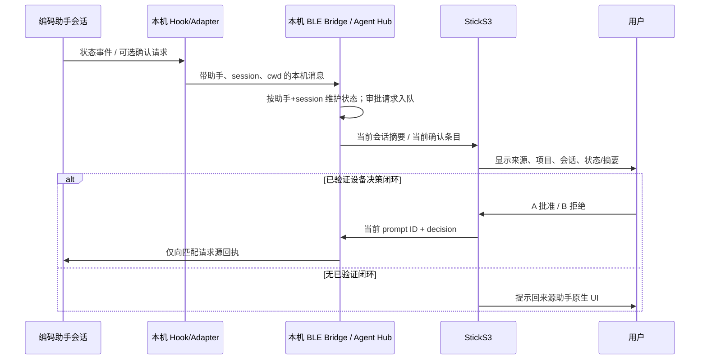

# 多编码助手状态与确认请求上 Stick

本 PRD 定义 Codex Buddy 对多编码助手/会话状态与权限确认的首版增量，供产品负责人评审范围、验收和隐私/权限边界。评审通过后，下一阶段再确认是否需要原型，并细化测试与实现方案；本文本身不授权实现或设备操作。它依赖已批准的 `clarify.md` 和用户明确决策：仅本机 bridge + 一台 Stick；首版助手为 Codex、Pi、Hermes、Cursor、DSH；按助手会话分别显示；Stick 标签为助手名、项目目录末级名称、会话短标识；缺稳定标识使用 bridge 本次运行短序号；无明确工作目录显示“未知项目”；2026-10-28 用户明确批准仅对已经验证完整设备决策闭环的请求在 Stick 批准/拒绝，其他助手只提示需确认并由各自原生 UI 决定。

## 产品模式

- `product_mode=one_to_n`；来源：用户于 2026-10-28 明确选择“现有产品增量演进”。
- `mode_detection=explicit`、`clarification_style=single_question`；继承 `.product-workflow-config.json`。
- 因为已有 Agent Hub、BLE packet、Stick 屏幕和 Codex approval 通道，本需求修改现存状态身份、轮播和权限请求链路；必须保持未改动的用量仪表、Codex 单会话与 BLE/NUS 行为兼容，并明确其他助手不具备已验证审批闭环时的回退。
- 用户已于 2026-10-28 明确评审并批准本 PRD；批准后按 `stage-gated` 进入下一阶段。

## 项目上下文探索

### 范围与知识入口

- 工作流切片：`docs/product-development/2026-10-28-multi-agent-stick-status/`；活跃仓库根：当前 Git 工作区根目录。当前 HEAD `f0310834aad84c55bbe3ab38a3ed5e2e1e8d7461`；本地工作区原有配置/画像改动及本切片文件不属于该 HEAD。
- 配置：`.product-workflow-config.json` 指向当前根目录，`product_mode=one_to_n`、`code_exploration=required`、`test_automation=required`、`unit_test_infra_check=required`、`portal_sync=off`。
- 复用 `docs/repo-wiki/index.md`、`docs/repo-wiki/architecture.md`、`docs/repo-wiki/development.md`。没有 `project-wiki.md`；项目配置将项目 Wiki 设为 optional，本切片不复制仓库地图。设计上下文检测未命中 `PRODUCT.md` / `DESIGN.md` / impeccable；Stick UI 的事实依据是现有固件，而非臆造 Web 设计系统。

### 实际探索证据

- 关键词：`agent hub`、`session_id`、`cwd`、`PermissionRequest`、`hook-approval`、`agent_count`、`dsh`。
- 实际搜索：`rg -n -i "dsh|dsh hook|session_id|cwd|PermissionRequest|agent_hub_hook_tee|agent_hub_notify|agent_count|approval.sock" README.md REFERENCE.md docs plugins tools src integrations`。
- 实际回查：`tools/codex_usage_ble_bridge.py` 中 `AgentHub`、`CodexApprovalProxy`、`UsageSnapshot.packet`、CLI 参数；`src/data.h` packet parser；`src/main.cpp` 屏幕布局、批准交互；`plugins/codex-usage-stick/scripts/hook_entry.py`；`plugins/codex-usage-stick/hooks.json`；`integrations/agent-hub/install_presence.py`、`integrations/agent-hub/pi/index.ts`、`integrations/agent-hub/hermes/`；`tools/agent_hub_hook_tee.py`、`tools/agent_hub_notify.py`、`tools/test_agent_hub.py`；插件 README 与 repo wiki。
- 已确认：`HubAgent` 有可选 `session_id`，但 AgentHub 当前以 agent 类型为 key；`cwd` 未纳入 Hub 数据；packet 只带当前助手名称/ID、index/count，不带项目/会话短标签。现有 roster 轮播 idle 12 秒、busy 28 秒、人工切换 grace 45 秒；状态 packet 默认按 10 秒间隔推送，变更时跳过相同 packet。
- 已确认：Codex 插件 `PermissionRequest` 将 hook 发给本机 `approval.sock`，bridge 建立 prompt future、队列请求、BLE 展示 prompt ID/tool/hint，并将 Stick 的 allow/deny 映射回该 hook；hook 等待上限由 hook `45s` 配置及 bridge timeout 控制。其他 Codex app-server 请求另有 RPC 回应路径。固件当前批准页展示 tool/hint，A accept、B cancel；prompt ID 用于将设备决定关联到队列请求。
- 已确认：Pi 扩展和 Hermes 插件已有存在/状态 hook，提供 session/cwd 字段；Cursor 的安装脚本注册存在 hook event，但当前命令参数没有显式添加 `client_kind=cursor` 之外的 session/cwd 解析；测试只覆盖按 agent 类型的 roster，未覆盖按 session 分裂。
- 已确认：`integrations/agent-hub/install_presence.py` 仅实际安装 Cursor、Pi、Hermes；它打印“dsh: no stable hook surface yet”。通用 notifier 和 Hub 识别 `dsh` envelope，但不等于有 DSH adapter。当前机器的 `dsh --help` 说明这是 DeepSeek Harness profile launcher（本机安装包 `@deepseek-ai/dsh` `0.2.1-rc.3`）；`dsh` CLI 帮助没有展示可直接配置的 hook 事件。仓库未找到 DSH 官方/稳定 hook API 契约，因此 DSH 可行接缝、稳定事件、会话 ID、cwd 和审批回调均须开发前从真实安装/profile plugin 契约核实，不在此宣称已实现。
- 未运行测试、固件编译、BLE/设备验证、真实助手 hook 或权限闭环，也未安装/启用插件或修改用户助手配置。静态搜索只能证明仓库现状，不能证明各助手当前版本的完整运行兼容性。

### 探索影响与不确定性

| 不确定项 | 来源/影响 | 是否阻断本 PRD | 后续阶段影响 |
|---|---|---|---|
| DSH 能否通过受支持的 profile plugin 提供稳定状态 hook、session/cwd 和退出事件？ | 仓库明确没有稳定接入；影响 DSH adapter 的技术路径。 | 否；需求明确要求 DSH 支持，PRD 将实际接入列入范围，技术方案须验证契约；若不可实现必须回到产品负责人裁决。 | 阻断技术方案最终定稿与 DSH 实现，不阻断当前 PRD。 |
| Pi/Hermes/Cursor 的具体版本与 hook payload 字段是否一致？ | 仓库集成各有实现，但没做真实运行验证；影响 session/cwd 支持矩阵。 | 否；按“字段存在则使用、缺失按已确认回退”验收，并在测试计划覆盖。 | 测试和技术方案列出版本/字段核验责任。 |
| 各非 Codex 助手是否能由 Stick 决策权限请求？ | 当前没有已核实设备决策闭环；用户明确限制仅“已验证闭环”可在设备批准。 | 否；用户已明确授权门禁，本 PRD 记录为已确认规则。 | 新增助手审批闭环须后续单独验证并扩展，不得暗中纳入本期。 |
| 屏幕可同时展示的 session/请求数量与刷新阈值 | 现有显示为单项轮播，10s packet 周期；需要在现有固件约束下确定。 | 否；PRD 定义基于有界列表/轮播的可观察行为，具体上限作为实现验证参数。 | 原型/技术方案需按实机分辨率和 BLE payload 做边界验证。 |

## 背景与问题

用户同时运行多个编码助手或同一助手的多个会话时，现有 Agent Hub 以助手类型合并状态，无法准确回答“哪个实例正在工作/等确认”。Stick 目前逐条显示审批，但屏幕没有稳定显示请求所属的助手/项目/会话；若多个来源状态合并或迟到决定关联错误，可能造成用户误判甚至错误授权。

产品要在同一台电脑的本机 bridge 和一台 Stick 内，将状态对象细化到助手会话，并将设备端授权限制在已验证、能精确把决定回传到请求源的闭环。未具备闭环的助手只呈现需确认状态，用户回各自原生 UI 决策。

## 目标用户与任务

- **目标用户**：本机同时使用 Codex、Pi、Hermes、Cursor、DSH 中一个或多个助手的开发者；拥有并使用 StickS3 查看状态/接收确认的人。
- **核心任务**：一眼区分并行助手会话的运行状态；定位哪个会话需要用户处理；在支持安全闭环的请求上直接通过 Stick 决策；否则跳回来源助手原生界面处理。
- **使用环境**：单机本地 bridge + 单个 BLE 连接 Stick；无需云端、跨电脑或团队后台。

## 目标与非目标

### 目标

1. 以助手实例/会话作为状态实体；相同助手的并发 session 不合并。
2. Stick 轮播/查看各 session 的助手名、项目目录末级名、会话短标识和状态；缺失稳定 session ID 使用 bridge 本次运行短序号，缺明确 cwd 显示“未知项目”。
3. 逐条呈现挂起确认请求并显示正确来源标签。只有具备经验证的端到端决策闭环的请求显示可用的 A/B 批准/拒绝；其它来源只提示“需在原应用确认”，不得发送 device decision。
4. 将 DSH hook/adapter 的真实接入纳入本期，不以 Hub 接受 `client_kind=dsh` 代替实际支持。
5. 保留现有 Codex 使用额度、Stick 配对/BLE、单会话状态和未接入时原生权限 fallback。

### 非目标

- 跨电脑/跨 Stick/云端汇聚，远程权限决策、团队监控或历史报表。
- 替未列入首版的其他助手安装 adapter。
- 未先完成请求来源、身份、超时和回执验证就开放非 Codex 的 Stick allow/deny。
- 展示完整 cwd、完整提示词、凭据、任意原始 hook payload；把状态或请求发往外部服务或做持久化历史。
- 重做用量仪表、角色系统、BLE 配对机制或所有助手的原生审批 UI。

## 用户旅程、故事与验收追踪

| 旅程 | 用户故事 | 验收标准 |
|---|---|---|
| J-001：多个助手会话运行时，在 Stick 浏览并识别正在工作/等待的会话 | US-001、US-002、US-003 | AC-001、AC-002、AC-003、AC-004 |
| J-002：收到确认提示后，识别来源，选择在 Stick 安全决定或回到来源 UI | US-004、US-005 | AC-005、AC-006、AC-007 |
| J-003：会话结束、来源离线或字段缺失时，维持准确、隐私最小且兼容的显示 | US-002、US-006 | AC-003、AC-004、AC-008、AC-009、AC-010 |

该矩阵把旅程与可判定验收关联，避免只完成“有个状态图标”却无法区分会话或安全响应请求。

## 用户故事

- **US-001 会话独立识别**：作为多助手开发者，我希望同一助手的并发会话各自有条目，避免一个会话的状态覆盖另一个。
- **US-002 状态查看**：作为开发者，我希望 Stick 按可浏览的顺序展示助手名、项目末级目录、会话短标识和状态，便于定位活动实例。
- **US-003 不确定状态可见**：作为开发者，我希望状态未知/离线与 idle 区分，避免 hook 缺失时误以为助手空闲。
- **US-004 安全设备审批**：作为用户，我希望对明确具备完整回执闭环的请求在 Stick 逐条批准或拒绝，决定只作用于当前展示的请求。
- **US-005 原生 UI 回退**：作为用户，我希望不支持设备决策的助手仍能提示需要确认，并知道回原助手 UI，而不是给出会被误认为已批准的按钮。
- **US-006 隐私与兼容**：作为本机用户，我希望 Stick 只显示决策所需短信息，并保留现有 Codex 单助手、额度仪表与 BLE 行为。

## 功能范围与规则

### 会话身份与状态

- 逻辑主键为 `(assistant_kind, stable_session_id)`。来源无稳定 ID 时，bridge 分配仅本次进程生命周期有效的序号；不能将其伪装为跨重启稳定身份。项目标签仅从来源明确提供的 cwd 派生末级目录名；字段缺失/无效显示“未知项目”，不得使用 hook 脚本/插件 cwd 推断。
- 可读身份为 `助手名 · 项目末级目录 · 会话短标识`。在 Stick 空间不足时可分行/截断，但项目末级名与会话标识不得都被截掉；列表/轮播位置应可发现。
- 允许状态至少包括：`busy`（工作中）、`attention`（需确认）、`idle`、`completed`（短暂完成）、`offline/unknown`。超时或来源退出不能继续显示为 busy；无 hook/进程证据时不得冒充 idle。
- SessionEnd 仅结束对应会话，不可删除同助手其他会话。未知/重复/迟到事件不得创建错误归属或清除其他会话。
- 五种首版助手名固定映射：Codex、Pi、Hermes、Cursor、DSH；未知类型不属于首版支持。状态接入不意味着审批闭环。

### 确认请求与决策授权

- 每个挂起请求须拥有唯一 request/prompt ID、助手来源、session 归属（若来源能提供）、请求类型/最小摘要、生命周期与一个可验证响应目标。
- 队列中每条待确认请求都可逐条呈现来源；同时等待时不得把多个请求合并成一个 approve/deny。请求失效、超时或已由原生 UI 处理时必须撤销/刷新当前设备 prompt，迟到按键不得落到下一条。
- 设备端决策启用条件：该来源已有真实适配器；请求 ID 与来源 session 可追溯；批准/拒绝结果有明确定义并回传到原请求方；拒绝、超时、取消、断连和重复决定路径均经测试。任一条件不满足，Stick 只能提示“请在 `<助手名>` 中确认”，不显示可执行批准/拒绝选项。
- 当前代码已核实的完整设备闭环为 Codex plugin `PermissionRequest` → 本机 `approval.sock` → bridge pending/future → BLE prompt → prompt ID decision → hook allow/deny。Codex app-server approval path 另作已存在通道核验，不扩大对其他助手的授权。
- 其他助手的权限请求只有在本期实现完成对应适配并通过端到端验证后才能列为可设备决策；默认状态提示路径不等待 Stick 决定、不拦截原生应用权限流程。
- BLE 断开/Stick 无响应时，Codex hook 按现有行为恢复原生审批 UI；不支持设备决策的来源始终由原生 UI 决定。不得因 bridge 无响应而默认 allow。

## 验收标准

- **AC-001 会话分裂**：给定同一助手连续上报两个不同稳定 session ID 的事件，Agent Hub 与 Stick packet 至少产生两个独立身份条目；其中一个收到 `SessionEnd` 后，另一个条目及状态保持不变。
- **AC-002 无稳定 ID**：若来源事件没有稳定 session ID，但能提供来源自身的临时会话句柄/可关联上下文，bridge 为该句柄在本次运行分配短序号，并对后续事件保持同一映射；bridge 重启后不要求标识稳定。若事件没有任何可区分或可关联会话的字段，bridge 不得声称识别出多个会话或生成貌似可追踪的实例，应将其作为单一“未知会话”条目或忽略无法关联的事件，并记录可观察的降级状态；不得将本机短标识写成来源稳定 ID。
- **AC-003 标签字段与空值**：有明确 cwd 时只显示其末级目录名，不显示父路径；cwd 缺失、无效或指向来源不明确时显示“未知项目”；稳定 session ID 显示短标识，否则显示运行期序号。
- **AC-004 状态生命周期**：`UserPromptSubmit`/工作事件使对应会话显示工作中；`PermissionRequest` 使对应会话显示需确认；SessionEnd/过期只影响对应会话；事件过期后不得继续显示工作中，且无证据不能标为 idle。
- **AC-005 多请求队列**：并发插入至少两条 pending 请求时，Stick 每次只展示一条且有正确来源标签和当前请求标识；逐条完成/撤销后按既定顺序显示下一条。任一决定不得作用于非当前请求。
- **AC-006 授权门禁**：不具备有效 request ID、来源回执或经测试闭环的助手请求只显示“需在原应用确认”，Stick 不发送 approve/deny；已验证支持的请求才显示 A/B 操作。
- **AC-007 决策正确性**：批准/拒绝当前有效 prompt 后，决定只回到匹配 request ID 和来源；重复点击、旧 prompt、超时、取消、断连或请求已在原生 UI 关闭时不得批准后续请求，失败时不默认 allow。
- **AC-008 DSH 接入**：安装 DSH adapter 后，真实 DSH session 的 start/activity/end 状态可通过本机 bridge 到达 Hub/Stick，包含 DSH 身份与可用 session/cwd；缺失字段按 AC-002/003 降级。实现前须记录所依据的 DSH 稳定 hook/plugin API 与版本；如果没有受支持接缝，不得以只识别 envelope 宣称通过。若技术方案验证后没有可用受支持接缝，则 DSH AC 判失败并阻断本切片实现/交付，不得由实现阶段自行删掉 DSH 范围；必须回产品负责人重新评审、修订 PRD 并批准范围变化。
- **AC-009 本机与隐私**：多助手 hook/权限消息仅经本机 socket 和已配对 Stick BLE 传输；测试检查设备 packet 不含完整 cwd、完整 prompt、凭据或未经允许的原始 hook 对象；不得新增云端传输或持久化请求历史。
- **AC-010 回归兼容**：已有 Codex 单会话状态、Codex 硬件审批及原生 fallback、额度仪表/角色状态和非 Agent Hub JSON packet 继续工作；session 列表更新不破坏既有用量字段和设备交互。

## 当前流程与目标流程

当前代码实际实现了按助手类型轮播和 Codex prompt 闭环；目标流程增加 session 身份键、来源标签和基于 capability 的设备决策门禁。时序图强调决定不得因队列推进而转投下一请求。

### 状态机

| 当前状态 | 事件 | 下一状态 | 设备行为 |
|---|---|---|---|
| 未登记 | SessionStart / 首个活动 | idle / busy | 新建助手会话条目 |
| idle | UserPromptSubmit / 工作事件 | busy | 刷新该会话活动时间 |
| busy | PermissionRequest | attention | 更新该会话；若请求进入队列，另显示对应 prompt |
| attention | 有效设备决定 | busy / idle / completed（由来源事件确定） | 只回传匹配 request ID |
| attention | 无设备闭环请求 | attention（原生待处理） | 仅状态提示，不展示可决策按键 |
| 任意活动态 | SessionEnd / 超时 | 已移除 / offline | 只移除或降级对应会话；失效 prompt 撤销 |
| 任意态 | 来源字段不足 | unknown / 可降级实例 | 标签按已确认 fallback，不错误合并 |

状态表用来判定完成、断连和缺字段条件，而不是将所有 hook 映射成一个 agent 总状态。

## 原型约束契约

本需求涉及 Stick 屏幕交互；若后续用户选择 HTML 原型，该原型按现有设备 UI 约束表达，而不是设计 Web 控制台。

### 页面 / 状态清单

| 屏幕/状态 | 目的 | 入口 | 退出 | 追踪 |
|---|---|---|---|---|
| 现有用量仪表 + 当前会话头部 | 保持用量展示，同时识别当前助手/项目/会话/状态 | 连接且有会话状态 | 实体按键轮播、进入现有信息页 | J-001 / AC-001..004、010 |
| 会话轮播项 | 查看并行会话的标签、状态与序号 | 仪表上的现有多助手轮播交互 | 下一条/上一条或等待自动轮播 | J-001 / AC-001..004 |
| 可设备决策的批准页 | 展示当前有效请求来源、工具和有限摘要，明确 A/B 决定 | 已验证闭环请求进入队列 | 决策后下一请求/仪表 | J-002 / AC-005..007 |
| 原生 UI 确认提示 | 告知请求需要回对应助手操作，不伪装可批准按钮 | 不支持设备决策的请求 | 请求结束/原生确认后状态更新 | J-002 / AC-006..007 |
| 空/离线/未知状态 | 表示没有活跃来源、bridge 离线或身份字段不足 | 状态缺失、BLE 断开或字段缺失 | 恢复事件或连接 | J-003 / AC-003、004、008 |

### 入口、交互和显示字段

- 复用现有正常仪表、自动轮播、实体按键和 A/B 批准页；不新增独立主菜单或 Web 配置界面。
- 会话标签结构：助手名、项目末级目录、会话短标识；短标识稳定时优先来源 ID 的截短值，否则运行期序号。无 cwd 显示“未知项目”。屏幕可以分行截断，不能显示完整工作路径。
- 状态文字使用已有语义：工作中 `BUSY`、需确认 `ATTN`、空闲 `IDLE`、完成 `DONE`；新增 `OFFLINE/UNKNOWN` 如现有字符宽度允许，否则在文本区明确表达，不以 `IDLE` 代替未知。
- 批准页必须同时看得到来源助手/项目/会话与请求类型/最小摘要；只有可设备决策时显示 `A: accept` / `B: cancel`。否则明确“回 `<助手名>` 确认”，按键不触发 approve/deny。
- 不能把完整路径、完整命令/提示、token、密钥等塞入小屏或样例。请求摘要应只用现有 request 字段、截断并最小披露。

### 主流程与状态覆盖

1. 展示两个不同 Codex 会话时，按既有轮播查看 `CODEX · <项目末级名> · <短标识>`，分别显示工作态。
2. 一条 Codex 已验证审批与一条非 Codex 待确认请求同时存在时，逐条展示且身份不串；Codex 可 A/B 决策，非 Codex 只给原生 UI 提示。
3. 确认队列中当前请求超时或从原生 UI 撤销时，撤销旧 prompt，再展示下一条；旧按键不会作用于新条目。
4. 未知 cwd、缺 session ID、无 BLE/bridge、会话结束、空 roster 均有明确标签/状态，不显示错误的工作中/批准态。

### 设计事实与原型红线

- 现有设计证据：`src/main.cpp` 的 135×240 portrait 与 landscape 仪表、角色动画和权限 overlay；`src/data.h` 解析 JSON packet；`src/main.cpp:914` 的批准 UI；复用已有颜色、字号、屏幕空间与物理按键语义。
- `PRODUCT.md`、`DESIGN.md`、impeccable 未探测到；若交互原型进入下一阶段，按源码现有 UI 复用，具体在原型阶段核对屏幕截图/渲染，不能凭空增加风格系统。
- 禁止在非闭环请求上画可操作 approve/deny 按钮；禁止将多个请求合并为一个确认；禁止展示完整路径；禁止以“设备离线时自动批准”作为成功态。
- 原型路线尚未由用户选择；stage-gated 流程在 PRD 评审通过后才询问是否制作交互原型。

## 约束、兼容、发布与回滚

- 本机范围：Codex/其他助手 adapter → 本机 Unix socket → BLE NUS → 一台 Stick；不新增网络服务或云数据面。
- 共享 packet 消费者：Python `UsageSnapshot.packet()` / `BleSession.write_json()` 输出 JSON；固件 `src/data.h::_applyJson()` 解析；`src/main.cpp` portrait/landscape chrome、轮播和 prompt 操作消费；`tools/test_agent_hub.py` 验证 Hub packet；`tools/test_provider_quota.py` 覆盖 usage packet。新增字段须向后兼容，旧固件忽略未知字段；不能移除现有 `agent`/`agent_id`/index/count 或额度键。
- 用户助手配置写入只允许通过明确的安装/更新流程，不得在开发阶段自动修改 `$HOME` 下 Cursor/Pi/Hermes/DSH 配置。提供可审查、幂等、可撤销的 adapter 安装入口；安装前保留未知用户 hook，不能覆盖用户配置。
- 发布策略建议：先发布本机 bridge/plugins 与匹配固件；新 packet 字段采用可选字段，固件未升级时保留现有单 agent/approval packet 行为。DSH adapter 依赖契约未核实前不得将其标为可用。
- 回滚：停止 bridge/恢复旧 adapter 配置并回退兼容固件；安全决策开关回到仅 Codex 已验证闭环，清空/忽略失效 prompt 不可使 pending hook 默认 allow。具体升级/回滚命令由技术方案与用户批准的 release 步骤确定。

## 成功指标

- **正确区分**：在离线 packet 测试输入两个同类型不同 session，输出对象数为 2；SessionEnd 对一个不影响另一个。
- **身份正确**：稳定 ID、运行期序号、cwd 末级名/未知项目在 packet 和 Stick 显示结果均符合 AC-002/003；完整 cwd 不进入 BLE prompt/dashboard 字段。
- **审批安全**：自动化并发、超时、撤销、重复与迟到决定用例中，错误 request/source 决策数为 0；无闭环助手在设备无有效批准/拒绝命令。
- **状态新鲜度**：bridge 默认 packet 周期为 10 秒，因此 PRD 建议活跃状态在来源事件后不超过两个正常推送周期（20 秒）到设备显示；此为待实现测量的产品目标，不代表当前设备实测性能。
- **DSH 可用性**：真实 DSH profile 的 start/activity/end 至少各验证一条事件到 Stick 的路径；若官方受支持接入面无法提供必需字段，报告阻断并回到产品负责人，不以模拟 envelope 作为端到端成功。
- **回归**：现有 Python 无硬件测试与固件编译通过；BLE/按键/真实 helper 闭环单独记录为设备实测，不能由编译替代。

## 假设、风险与待确认

- **待核实依赖**：DSH profile plugin 加载契约/生命周期；Pi、Hermes、Cursor 的稳定版本/API 与 hook 字段；Codex hook 真实 payload 的 session/cwd 字段；屏幕 portrait/landscape 布局空间。
- **安全风险**：身份短标识截断冲突；请求 timeout 和原生 UI 外部处理后的 stale prompt；队列推进竞态；跨会话事件被错误合并。必须用 request ID 与 session 归属测试兜住。
- **隐私风险**：cwd 末级名和命令摘要仍可能含敏感项目/信息；默认本机处理、最小展示、截断、不持久化，不上传外部。
- **容量风险**：大量会话/请求无法同时显示；采用可浏览/逐项队列并在状态中给出总数/当前位置。具体最大数由真实 BLE payload 和屏幕压测确定，不能截断后悄悄丢掉挂起请求。
- **未确认但不阻断本 PRD**：目标延迟基准是建议值 20 秒；最大同时活跃会话及请求数需技术方案实测；DSH 对外 plugin 接缝需确认；是否产品原型阶段必做交互 prototype 依流程另问。

## 对抗审查

### 人机两句

1. 未参加讨论的评审人可从摘要确认用户、单机范围、五助手名单、会话标签、权限授权门禁和待决策：通过。
2. 工程师只读本 PRD 与仓库章程，可知道身份语义、权限回退、兼容约束和 AC；DSH 接口、容量与硬件 UI 细节仍须技术方案/实现前核实：部分通过，未把未知接口写成事实。

### 三轴审查

独立对抗审查发现三项需修订内容，均已在本次稿内处理：

- **权限事实归属**：首稿将设备审批门禁写成用户已确认，但澄清原稿当时仅记为建议。用户随后明确回复只对已经验证完整设备决策闭环的请求在 Stick 决策，其他助手回原生 UI；现稿已将该回复作为明确业务决策记录在抬头、上下文和授权规则中。
- **缺失 session ID 的可判定性**：首稿未说明没有 stable ID 时如何判定两个来源事件属于不同会话。现 AC-002 规定来源临时句柄/关联字段可用时只在 bridge 运行期间映射短序号；任何关联依据都不存在时，按单一未知会话/忽略无法关联事件降级，禁止伪造会话区分。
- **DSH 不可接入时的范围处理**：首稿未明确真实 DSH adapter 接缝不存在时的验收结果。现 AC-008 明确此为失败并阻断交付，必须回产品负责人重新评审、修订并批准范围变化，不允许实现阶段静默删范围。

| 轴 | 发现 | 建议 |
|---|---|---|
| 规格 | DSH 的稳定 hook/plugin API 尚无仓内证据，用户已批准支持 DSH，但不能在 PRD 写成已有能力。 | 已将真实 DSH adapter 纳入范围，并把接口核实设为技术方案/实现依赖；没有稳定接缝时必须回产品负责人裁决。 |
| 可判定 | 并发容量及 UI 真实布局上限未由静态证据确定。 | AC 按并发至少两条和正确归属判定；最大容量在技术方案实机/packet 尺寸核验前保持待定，不宣称无限。 |
| 事实 | 当前 Hub 按 assistant kind 聚合；Cursor 安装脚本、DSH adapter、其他助手审批闭环能力受实现限制。 | 背景章节区分当前代码事实与本期目标；仅 Codex 作为已有闭环，不把状态 hook 当权限回执。 |

**结论**：本轮 PRD 先根据对抗审查补全已批准权限边界、无稳定 ID 的安全降级和 DSH 接入失败处置。以上接口/硬件容量均已列为后续阶段技术核验项。PRD 仍为 `Draft`，等待用户批准。

## 评审决策与未解决项

请评审人确认本期范围、US/AC、非目标和隐私默认。用户已在 PRD 编写前明确批准设备决策授权门禁，该边界不是待审批建议。未解决项包括 DSH 受支持 hook 接缝、各来源字段/版本兼容、最高并发 roster/队列容量和建议的 20 秒状态新鲜度；它们会影响 US-001/002/003/AC-001..004/008/009 的实现参数，但不改变当前用户旅程和授权边界。DSH 接缝缺失时按 AC-008 阻断切片，不允许静默删范围。
