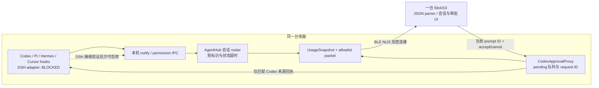
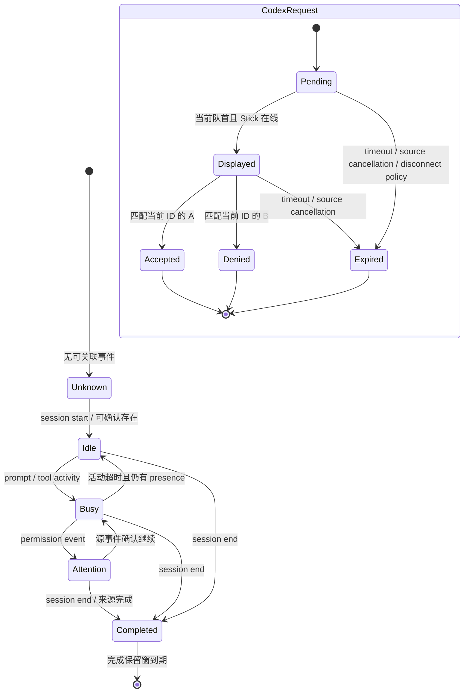

# 技术方案：多助手 Stick 状态与确认（Draft，概念方案）

## 阅读上下文与评审决定

本方案承接已批准的 PRD、Stick 交互原型、测试用例和自动化测试计划，描述单机 bridge + 一台 Stick 上按助手会话展示工作/待确认状态，并逐条呈现请求的最小演进方向。评审人为用户/产品负责人、bridge 与固件维护者；请确认模块边界、可选 packet 路线、Codex 独占设备决策门及下列阻断假设。

**重要边界：这是获用户授权先行的概念方案。DSH 的实际 plugin mount、生命周期 payload 和端到端事件路径尚未验证；DSH adapter 的实现/安装/启用以及宣称 AC-008 通过的工作不得启动。** 本方案不把概念字段或结构图当作已冻结合同，也不构成实现批准。其他助手设备审批闭环同样不在已验证范围，继续仅显示回原生 UI。

依赖 `prd.md` AC-001..010、`prototype.html`、`test-cases.md` TC-001..026、`automation-test-plan.md` AUTO-TASK-001..007，以及当前仓库源码。原型仅为交互参照，不是实际设备能力证据。模式为 `one_to_n`，完整流程 `stage-gated`，`portal_sync=off`。配置 freshness 与当前 HEAD 均为 `f0310834aad84c55bbe3ab38a3ed5e2e1e8d7461`；没有 stale-config continuation。

## 不确定性清单与工程决策

用户明确授权按概念方案继续，因此以下未决事项作为显式阻断假设保留。DSH 实接为用户批准的范围，不因该不确定性而静默删减；需要凭证的实现任务暂停，待证据齐全后回到产品负责人复核。

| 编号 | 来源与影响 | AC/TC | 是否阻断 | 回前序修订 |
|---|---|---|---|---|
| U-001 DSH 的受支持插件挂载、事件名、真实 payload 和卸载/生命周期未在本仓验证；影响 DSH adapter、Hub 接入和部署 | 本机 CLI 版本/类型声明只证明存在相关类型；官方文档不是当前 profile 的运行事实 | AC-008 / TC-018 / AUTO-TASK-007 | **阻断 DSH 实现和切片验收**；概念方案继续 | 若无受支持接缝，回产品负责人修改范围并重新批准 PRD；不允许实现阶段自行跳过 |
| U-002 Codex/Pi/Hermes/Cursor 实际 payload 的稳定会话关联、cwd 可用性需逐 adapter 对照 | 当前仓库 hooks 与测试 | AC-002..004 / TC-001..009 | 阻断冻结映射字段；不阻断接口族群概念 | 发现字段契约冲突则回修 PRD/TC |
| U-003 活跃会话数、pending 队列上限、BLE 单包/分片预算、屏幕长标签布局未测量 | NUS 和固件 parser/UI | AC-005、010 / TC-025..026 | 阻断最大容量与发布参数；不阻断可选字段思路 | 不需要，技术实现前验证 |
| U-004 Stick JSON parser host-test seam 未确认 | `src/data.h`、PlatformIO | TC-022 / AUTO-TASK-005 | 阻断测试入口最终冻结 | 不需要，开发计划记录前置探查 |
| U-005 Codex app-server + hook permission 双入口的来源合并/取消竞态需现有实现回归 | `CodexApprovalProxy` | AC-005..007 / TC-010..017 | 阻断授权逻辑变更；概念方案明确复用，不拓展 | 如发现当前闭环不能满足 AC 则回产品负责人/PRD |

### DSH 已知与未知的边界

本机 `dsh --version` 对应安装包 `@deepseek-ai/dsh` `0.2.1-rc.3`；包中依赖 Cordis，README 描述 profile/plugin 管理；本机依赖类型声明可见 session/cwd 等相关定义。此前公开文档检索材料也显示 session、tool、approval 事件扩展点。上述只支持“值得验证的接缝候选”，不证明此 DSH 版本中事件一定可被外部插件订阅，不证明插件会进入目标 profile，也不证明到 bridge/Stick 的数据路径。不得据此写真实 adapter，不得提交 DSH 用户配置或启用 profile。

## 当前系统上下文与证据

Repo Wiki 已读 `docs/repo-wiki/index.md`、`architecture.md`、`development.md`。导航基于同一当前 HEAD，但 Wiki 自述未梳理完整调用图；以下接口/状态事实以源码回查为准。Wiki 对方案的影响：沿用单仓所有权（bridge 管理会话和审批队列，固件消费 BLE JSON 并呈现），复用既有 NUS 和原生审批代理，不新建网络服务或第二份持久化状态；权限仍以 Codex proxy 的单请求回执为唯一已验证设备闭环；发布风险集中在新 packet/parser 屏幕容量与实体验证；DSH 是 ask-first 阻断项。

| 模块/文件 | 当前核实事实 | 方案影响 |
|---|---|---|
| `tools/codex_usage_ble_bridge.py:261`、`:374` | `HubAgent` 有可选 `session_id`，但 `AgentHub.agents` 的当前键按助手 ID 聚合 | 目标演进为会话键 roster；兼容既有单助手视图字段 |
| `tools/codex_usage_ble_bridge.py:658`、`:692` | `UsageSnapshot.packet()` 输出旧 `agent` / `agent_id` / index/count 以及额度等字段 | 新 roster 作为可选 JSON 扩展；旧字段和额度字段保留 |
| `tools/codex_usage_ble_bridge.py:1743` 后 | `CodexApprovalProxy` 管 pending、active prompt、hook socket、超时及 BLE 回执 | 复用并限定设备决定 capability；不得另造通用审批通道 |
| `plugins/codex-usage-stick/scripts/hook_entry.py` | Codex permission hook 经本地 IPC 等待 bridge 决定 | 现有请求/回执契约要保持；新 UI 展示仍由 request ID 绑定 |
| `integrations/agent-hub/install_presence.py` | 安装 Cursor、Pi、Hermes；DSH 仍报告未有稳定 hook 接缝 | 本期候选 adapter 只在验证接缝后加入安装流程 |
| `src/ble_bridge.cpp:13-15,89-133` | NUS BLE，连接安全与加密；JSON 通过 BLE 收发 | 沿用单机本地 transport，不增加云端或另开端口 |
| `src/data.h:129`、`:256-285` | `_applyJson()` 解析旧用量、agent 与索引字段 | 可选 roster parser 需兼容旧 packet；需评估 ArduinoJson 容量 |
| `src/main.cpp:914`、`:1609`、`:2047` | 现有 approval overlay 优先显示；屏幕 135×240、竖横屏与实体按钮已有语义 | 原型是布局参考；会话页和请求页扩展要复用现有界面能力 |
| `tools/test_agent_hub.py`、`tools/test_provider_quota.py` | 离线 `unittest` 覆盖 Hub 与 quota packet | 扩展离线回归；不把设备测试脚本混入 |
| `tools/test_serial.py`、`tools/test_xfer.py` | 串口/设备操作 | 禁止进入普通离线门禁，需单独设备授权 |

本轮只做只读代码探查和文档写作；没有运行时 DSH 插件、设备、BLE、用户 profile 或安装脚本。

## 架构概览与组件职责

增量目标是在现有 bridge/Hub 和 Stick UI 间增加**运行期会话 roster**，保留旧 usage 单项字段作为兼容快照。Hook/adapter 只把来源事件规范化后送至 bridge 本机 IPC；bridge 是会话状态、短序号和 pending 队列的唯一运行期 owner；BLE 发送经过白名单裁剪的数据；固件仅解析和显示，不成为授权策略源。请求决定仅能由已验证 Codex proxy 接收、核对、消费。

数据流/权限边界：来源 payload → 本机 adapter 白名单映射 → bridge session identity/state → packet 最小显示字段 → BLE → 固件 UI。未认证/不完整身份不得提升为确定会话；非 Codex permission event 只能作为注意状态展示，不能进入可决策 prompt。设备输入必须携带当前 Codex request token/ID，并经 proxy 中 pending 集合、active ID、状态与 capability 校验后消费。BLE 断连/超时/无效回执均 fail closed。

## 概念接口与字段（非冻结合同）

以下 JSON 是接口族群的概念形状，字段名称、长度、单包/多包、排序、限额须在开发前结合真实来源 payload 和 BLE 测量确定。不能直接按示例实现并宣称 schema 已批准。

| 族群 | 概念字段 | 产生/消费 | 校验与错误 |
|---|---|---|---|
| 本机 presence event | `source`、`event`、`session_key?`、`cwd?`、`observed_at` | adapter → 本机 notify → Hub | source 只接受批准首版；事件名映射表；cwd 只提取 basename；缺 session 关联时按 PRD 降级，不合并臆造；无效消息丢弃并记脱敏原因 |
| BLE roster 扩展 | `sessions: [{agent, project, short_id, state}]`（概念）及 `agent_index/count` | Hub packet → `src/data.h` → UI | 只传 display allowlist；不含完整 cwd/raw hook/prompt/credential；缺失字段显示“未知项目/未知会话”；旧包不含 `sessions` 时走原字段 |
| approval prompt | 复用当前 prompt message 的 ID/tool/hint 并概念加入来源显示标签 | CodexApprovalProxy → Stick | 只允许 `capability=device_decision_verified` 且 request ID 为 active pending；ID 不匹配、过期、重复、未知 decision 拒绝；非 Codex 显示原生 UI 指引，无按钮 |
| device decision | 当前有效 request ID + `accept` / `cancel` | Stick → BLE 回执 → Proxy | 鉴权/来源由现有 BLE bonding + proxy pending 绑定；错误不改变队列、不默认 allow；响应消费一次 |

本机 IPC 沿用已有 Unix socket 模式，不添加网络 endpoint；其具体 JSON 合同要回查 `agent_hub_notify.py`、`hook_entry.py` 和 proxy 后再冻结。本方案不新增鉴权 token、数据库、历史存储或迁移。socket 文件权限维持现有安全策略并在实现中复测。

## 数据模型、状态和兼容

### 运行期数据

概念实体 `SessionPresence`：`source_id`、`display_name`、来源稳定 `session_id` 或 bridge 运行期 `short_seq`、`project_label`、`state`、`last_event_at`、`origin_capability`。在 bridge 内以可靠关联键区分同一助手多会话；来源无可靠关联键时依 PRD 作为未知会话降级或忽略，不把 bridge 序号伪装成来源稳定 ID。项目标签只保存 basename。会话 roster 和队列只在进程内存中，进程退出清空，不保存请求历史。

概念 `PendingDecision` 只描述 Codex 已存在队列：`request_id`、`source_id`、`session_ref?`、`created_at`、`deadline`、`decision_state`。若无法可靠绑定 session，不从助手类型猜测归属；仍须依 request ID 精确回源。审计日志不得包含完整 payload。

### 状态迁移

请求与会话状态分开管理：pending 不自动让所有同助手会话都标需确认。状态过期、session end 只影响相同关联键；prompt 过期即撤销 UI 并推进队列，但旧 ID 永不重映射到下一项。

### 兼容、迁移与回滚

不引入持久 schema/数据库迁移。packet 仅增可选字段；保留 `agent`、`agent_id`、`agent_index`、`agent_count`、quota 与状态字段，旧固件忽略新增字段，新固件在无 roster 时走旧路径。须以旧 packet fixture 证明兼容，并对 JSON 文档大小、NUS chunk 策略和固件 JSON 容量进行测量。若单包不够，需在实现前设计显式分片/分页并验证不丢 pending，不可静默截断。

回滚通过停止新 adapter/bridge 并回到旧版本 bridge + 固件；关闭/移除可选 roster 字段后旧固件继续可用。若新 UI 或 packet 解析失败，固件应回退原用量/agent chrome；Codex 设备决策只有在现有 proxy 正常运行时开放，无法确认时回到原生 Codex UI，不改变 hook 的 fail-closed 策略。用户助手配置安装/卸载需单独授权、备份并可逆；本阶段不执行。

## 授权、安全、隐私与可靠性

- **设备决策能力**：启动白名单只含当前有已验证完整设备回执闭环的 Codex 路径。`source_id + request_id + active pending + deadline + capability` 全匹配才可消费；未覆盖助手始终是提示态，A/B 不生成授权动作。不能因为 DSH 或其它 adapter 能上报状态而获得 decision capability。
- **最小披露**：BLE 只含屏幕所需助手名、项目 basename、短会话标识、状态、请求类型和严格截断摘要。禁止完整路径、完整 prompt、任意 hook 对象、token/密钥。项目末级名仍可能敏感，遵循 PRD 的本机显示约束，不落历史。
- **IPC/BLE**：仅本机 socket 与已配对 Stick 的加密 BLE NUS；无外网服务、遥测或远程存储。socket 权限、JSON 类型与最大长度校验由实现及测试确认。
- **fail closed**：bridge 停止、Stick 离线、回执超时、原生 UI 先完成、重复/迟到按键均不默认批准，不将旧决定套到新队列项；超时回原生 UI 的具体时序须保持现有行为并有测试。
- **可靠性/性能**：状态刷新目标沿用 PRD/自动化计划建议，即来源事件后最多两个 10 秒正常推送周期内可见；尚未实测。上限会话数/请求数、BLE payload 大小与屏幕可读性待量化；方案要求队列逐项不丢弃，达到上限须显式显示 overflow/阻断行为，具体策略需测量后决策。
- **观测**：脱敏日志可记录 adapter kind、事件种类、关联成功/降级、活跃/待处理数量、请求 ID 的短 hash、超时/拒绝原因；不记录 cwd、prompt、原始事件、凭据。测试证据保留 commit、命令、退出码、用例数、脱敏事件摘要及设备版本。

## 测试、环境和质量门禁

自动化依据为已批准 `automation-test-plan.md`。AUTO-TASK-001/002/004 驱动 Hub、队列、packet/privacy 的单测与集成接缝；AUTO-TASK-003 覆盖 adapter 合同，但 DSH 只能在真实 API/profile 证据齐全后执行；AUTO-TASK-005 的固件 parser 测试入口先评估，不做大规模测试性重构；AUTO-TASK-006 保留 PlatformIO 编译及实体 Stick 手测；AUTO-TASK-007 当前为阻断状态。

| 层级 | 当前入口/建议验证 | 边界 |
|---|---|---|
| 离线 unit | `python3 -m unittest tools/test_agent_hub.py tools/test_provider_quota.py`；后续新增 approval/adapter/privacy tests | 现有命令尚未在本轮运行；测试不读用户 profile、不连 BLE |
| 本机 socket integration | 临时 Unix socket + fake transport/时钟，验证 request ID、取消、超时及 fail-closed | 不用真实账号或用户 socket |
| adapter contract | Codex/Pi/Hermes/Cursor 隔离 payload；DSH 真 profile 必须等 U-001 解除 | fixture 不能证明 DSH 真实接入 |
| firmware smoke | `pio run -e m5stack-sticks3` | 仅编译；本轮未运行，不等于设备验证 |
| 设备 E2E | 一台 Stick + 单机 bridge，旧包/新包、多个 session、队列、按键、断连与 Codex 原生回执 | 连接、配对、刷写均需用户另行明确授权；禁止默认自动执行串口脚本 |

### 单元测试基建缺口

已存在 Python `unittest` 脚本：`tools/test_agent_hub.py`、`tools/test_provider_quota.py`；命令为上述模块路径写法。本仓没有发现根级 pytest 配置/统一 runner/CI，也没有确认 JUnit 或 coverage 报告能力；固件 host test seam 未发现。若目标实现新增 Python 单测需生成机器可读报告或需建立/确认可重复测试入口，开发计划必须先安排 `$unit-test-init`，目标为本机离线可运行的 Python 测试入口及报告格式、最小验证命令，列出文件范围和验证步骤。本阶段不初始化、不安装依赖。既有脚本 stdout 作为当前入口证据，不虚构报告支持。

### Git Hook 质量门禁缺口

未发现自定义 `.git/hooks`（仅 sample）、`core.hooksPath` 未配置；未见 Husky、pre-commit、Lefthook 或其它 hook manager，也未确认 pre-commit/pre-push 的 lint/test/secret 扫描门禁。仓库跨 Python 与 PlatformIO 固件，但无可证实的多栈 hook 覆盖。开发计划需安排 `$git-hook-init` 开工前评估并配置轻量可验证的离线质量门（至少 Python 单测与可用的固件静态/编译验证策略）；如果 hook 会触发耗时硬件/刷写动作必须排除。当前不迁移、不安装 hook。

CI 未发现现成 workflow；是否新增 CI 与报告上传不在本期批准范围，维持本机和 PR 人工/已有平台流程，不新建云端依赖。

## 发布、回滚和观测

建议实现顺序：先在不触及用户配置/设备的隔离测试中冻结 presence event 与 roster packet；其次完成 Codex 既有闭环回归与非 Codex无决定断言；再实现固件可选字段解析和旧 packet fallback；最后在获准实体设备环境验证 BLE、屏幕和按键。DSH 另设前置 gate，未验证前不能安装或启用。切片发布必须同时记录 bridge、固件 SHA、助手/API 版本、设备结果及 AC/TC 证据。

发布前阻断：任何错误来源批准、跨 request 决策、隐私字段外泄、旧 packet 回归失败、DSH 接缝未确认，均不得宣称切片完成。若 DSH 无可用受支持接口，按 PRD AC-008 回产品负责人重新评审并修订范围。回滚不删除用户数据；状态数据为运行期内存，停 bridge 清空；用户配置仅通过明确可逆安装器管理。

## 备选方案与取舍

| 方案 | 优点 | 代价/不选理由 |
|---|---|---|
| A. 在现有 bridge AgentHub 中由助手 ID 改为 session key roster，并追加 packet | 最小增量，复用 BLE、额度、Codex proxy 和 Stick UI；单机数据所有权清晰 | 需兼容既有当前项字段；是推荐概念方向 |
| B. 新建独立 daemon / 云服务汇总所有助手 | 可独立扩展 | 违反单机本机 bridge 与隐私边界，增加部署/鉴权/存储，不选 |
| C. 每个 adapter 直接控制 BLE 或自行维护屏幕请求 | 局部简单 | 多写端、队列乱序、授权门分散，难保持 Codex 安全闭环，不选 |
| D. 只改显示名，将同助手会话继续合并 | 省 packet 与固件改动 | 无法满足按助手实例/会话独立展示与 session end 隔离，不选 |

## AC / TC / AUTO-TASK 追踪

| 需求 | 技术响应 | 验证/状态 |
|---|---|---|
| AC-001..004 / TC-001..009 | Hub 运行期会话 roster、basename/短 ID、超时和未知降级 | AUTO-TASK-001；真实 hook 字段仍需开发时核验 |
| AC-005..007 / TC-010..017 | 复用 Codex pending ID 队列与设备回执；决策 capability 白名单，非 Codex 原生 UI | AUTO-TASK-002；本方案未执行闭环测试 |
| AC-008 / TC-018..019 | DSH adapter 属于批准范围但受 U-001 阻断；不得开始实现或宣称通过 | AUTO-TASK-003/007 等接缝证据；回产品负责人处理不可接入 |
| AC-009 / TC-020..021 | BLE allowlist、本地 IPC、敏感 sentinel、无持久化 | AUTO-TASK-004；网络/文件差异仍需后续验证 |
| AC-010 / TC-022..026 | 可选字段、旧 packet fallback、quota 和 UI 复用 | AUTO-TASK-004..006；编译和硬件分别验证 |

## 评审未决项

请批准或指出需修改的概念架构、会话 roster ownership、旧 packet 兼容路线、Codex-only device decision gate，以及 DSH blocker 的处置纪律。未解决工程不确定项为 U-001（DSH 实际接缝，阻断 DSH 实现/交付）、U-002（各来源会话字段）、U-003（容量/包长/显示测量）、U-004（parser host test seam）、U-005（现有 Codex 竞态回归）。即使本方案获批，U-001 未解除前也不得启动任何 DSH 实现/安装/启用任务；其它实现也须等技术方案批准及开发计划/开工门禁完成。
