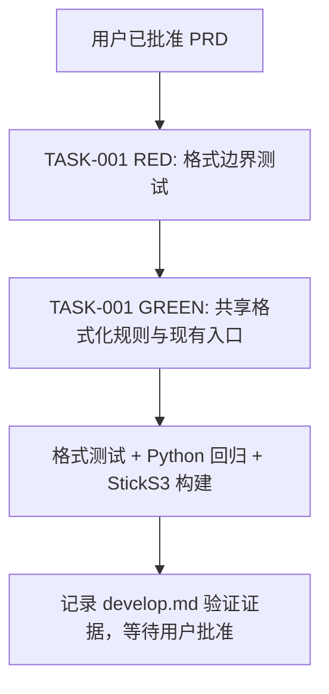

# 额度重置倒计时格式化函数（轻量开发计划）

本计划把已批准的轻量 PRD 拆为一个固件格式化任务。开发者按 AC-001 至 AC-005 实现并验证，不改数据协议或界面布局。PRD 已由用户于 2026-10-28 明确批准；轻量模式下本计划为执行拆解，状态保持 Draft，不另设批准门。

## 实现上下文

- 当前工作区是 codex-demo 固件仓库；产品目标设备为 M5Stack StickS3 / ESP32-S3，配置见 `platformio.ini`。
- `src/main.cpp:1104` 的 `resetText` 与 `src/main.cpp:1129` 的 `resetTimeText` 各自处理倒计时文本。`resetTimeText` 由 `drawUsageMeter` 路径调用；源码现有 `resetAt == 0` 或 `dataUtcNow` 失败时会输出空内容/由调用方画 `-`，需按 AC-005 改为 `NA`。
- 时间来源 `dataUtcNow` 位于 `src/data.h:103`，无同步 UTC epoch 时返回 false；过去的有效时间由显示格式化规则显示为已到点。
- 单测基础设施检查：仓库有 Python `unittest` 测试及 `python3 -m unittest discover -s tools -p 'test_*.py'`，但这不是 C++ 纯函数测试框架。当前环境有 `g++`，`pio` 可用；没有发现 PlatformIO native test 配置或固件 C++ 单测框架。Python 全量测试发现命令本轮已运行：24 项中 22 项通过，`test_serial` 与 `test_xfer` 导入失败，均因环境缺少 `serial` 模块；不得将其标作全量通过。`pio --version` 显示 PlatformIO Core 6.2.0；本轮尚未运行固件构建。
- 为直接验证固件格式逻辑，计划将纯格式化逻辑置于一个极小、无 Arduino 依赖的内部头文件，由 `src/main.cpp` 调用，并由 `tools/test_reset_countdown.cpp` 直接测试；该头文件仅作为本 PRD 所述固件模块的测试接缝，不新增公开 API。开发前需先检查 `src/main.cpp` 和测试入口上下文，若无法在不扩大职责的情况下建立共享实现，则暂停并回到计划评估，不写重复逻辑伪装测试。

## TASK 清单

### TASK-001：实现并验证倒计时格式化规则

- **关联验收**：AC-001、AC-002、AC-003、AC-004、AC-005。
- **文件范围**：`src/main.cpp`、仅为共享纯格式化函数所需的局部内部头文件（预计 `src/reset_countdown.h`）、针对性测试 `tools/test_reset_countdown.cpp`。不得改 `src/data.h`、BLE 协议、显示布局、颜色逻辑或其他模块。
- **Owner**：当前开发执行者；测试和固件入口保持单一 ownership，不并行实现。
- **RED**：先新增边界测试，运行 `g++ -std=c++11 -Wall -Wextra -pedantic tools/test_reset_countdown.cpp -o /tmp/test_reset_countdown && /tmp/test_reset_countdown`。预期因格式化实现缺失/规则不符而失败；先确认失败来自 AC 对应断言，再改生产代码。
- **边界测试预期**：剩余 `90061` 秒显示 `resets in 1d 1h`；`3661` 秒显示 `resets in 1h 1m`；`3600` 秒显示 `resets in 1h 0m`；`59` 秒与 `1` 秒都向上取整显示 `resets in 1m`；`0` 秒和负剩余秒数显示明确的已到点文案（沿用 `reset soon`）；无重置值、当前时间不可用或不可解析输入显示 `NA`。上述用例应覆盖 AC-001 至 AC-005。
- **GREEN**：实现可复用纯函数；对有效剩余秒数按天/小时/分钟格式化，不足一分钟向上取整；到点或负数明确显示已到点；不可用标志或无效输入显示 `NA`。更新两处现有格式入口使用同一规则，并保留合理的文本宽度约束。
- **验证命令**：
  - 目的：倒计时格式边界测试；位置：仓库根目录。
    ```bash
    g++ -std=c++11 -Wall -Wextra -pedantic tools/test_reset_countdown.cpp -o /tmp/test_reset_countdown && /tmp/test_reset_countdown
    ```
    证据：覆盖 AC-001 至 AC-005 的代表边界断言全部通过；先前 RED 需记录预期失败摘要。
  - 目的：既有 Python 回归；位置：仓库根目录。
    ```bash
    python3 -m unittest discover -s tools -p 'test_*.py'
    ```
    证据：测试发现与结果如实记录；环境缺少 `serial` 时不得宣称全量通过。
  - 目的：StickS3 固件编译；位置：仓库根目录。
    ```bash
    pio run -e m5stack-sticks3
    ```
    证据：PlatformIO 构建退出成功；依赖不可用或构建失败时记阻断/未通过，不扩大修复范围。
- **风险/回滚**：界面可用字符宽度有限，最终文案应沿用当前紧凑格式；如果新函数导致编译或显示回归，回滚本 TASK 的实现和测试改动，保留已有额度数据逻辑。

## 顺序、职责与执行方式

- 单任务、单文件所有权，由一个执行者串行完成；先 RED，再 GREEN，再执行 Python 回归与 StickS3 构建。不得把测试和实现并行拆分。
- 生产接缝只服务于本次格式规则；不引入通用库、第三方依赖、CI 配置或测试框架迁移。



## 风险与回滚

- 风险：仓库全量 Python 测试受本地缺少 `serial` 依赖影响；它不属于本次纯格式逻辑，不为绕过该失败安装依赖或修改环境。C++ 边界测试及固件构建分别提供本任务直接证据。
- 回滚：仅撤回 TASK-001 的格式化实现和测试接缝；不触及数据协议、输入缓存、系统时间同步及既有进度 UI。

## 对抗审查

- 人机两句：已批准 PRD 和本计划能让工程师明确执行一个任务；代码范围、顺序与验证有具体文件和命令。
- 规格轴：无发现；TASK-001 完整映射 AC-001 至 AC-005。
- 可判定轴：无发现；TDD RED/GREEN、格式断言、既有回归和固件构建各有命令与通过证据。
- 事实轴：无发现；当前函数位置、UTC 行为、测试失败原因与工具可用性为本轮源码读取/命令结果。尚未运行的格式测试与固件构建均明确保留为后续验证。
- 建议执行：单执行者串行执行 TASK-001；本计划不标记为单独批准阶段。
